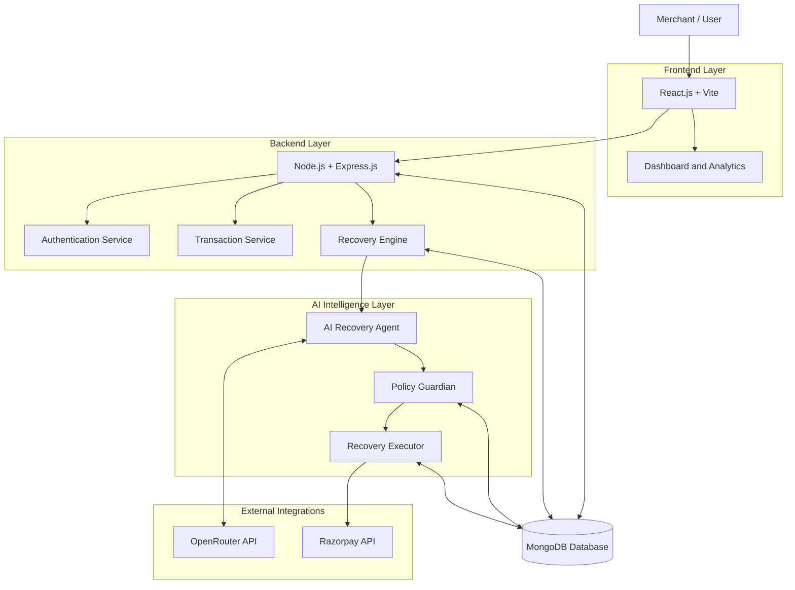
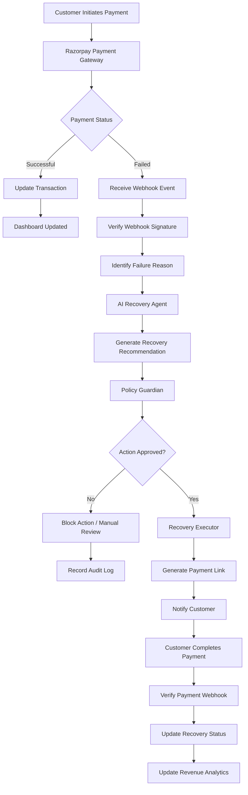
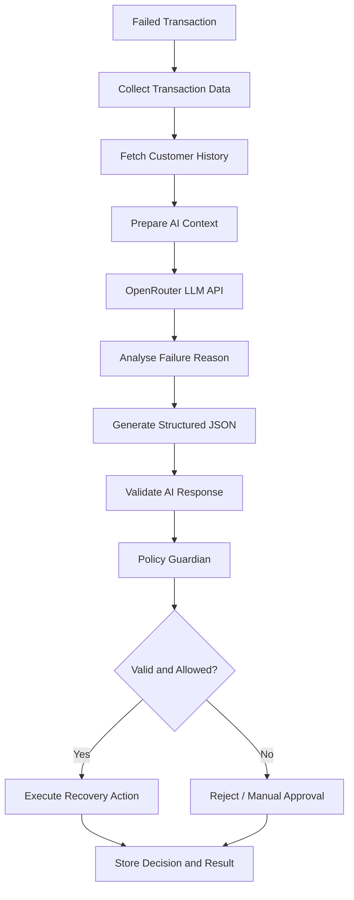
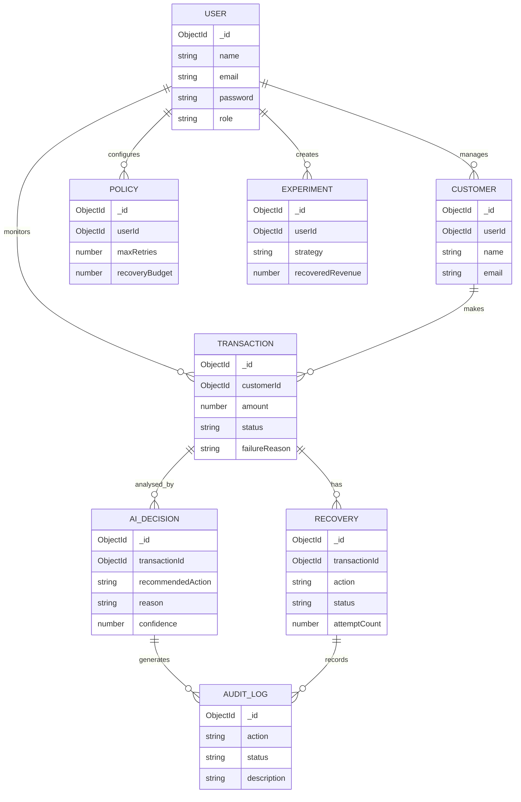

 
# 🚀 Revora AI
### AI-Powered Autonomous Revenue Recovery Platform

**Turning Failed Payments into Recovered Revenue.**

Revora AI is an intelligent payment recovery platform designed to help businesses recover lost revenue from failed transactions using AI-driven decision-making, automated payment recovery workflows, and intelligent policy enforcement.

Instead of relying on traditional fixed payment retries, Revora AI analyses transaction failure reasons, evaluates customer payment history, recommends suitable recovery strategies, and executes approved actions through integrated payment gateways.

---

## 📌 Table of Contents

- [Overview](#-overview)
- [Problem Statement](#-problem-statement)
- [Our Solution](#-our-solution)
- [Key Features](#-key-features)
- [Technology Stack](#-technology-stack)
- [System Architecture](#-system-architecture)
- [Payment Recovery Workflow](#-payment-recovery-workflow)
- [AI Agent Architecture](#-ai-agent-architecture)
- [Database Design](#-database-design)
- [Project Structure](#-project-structure)
- [Installation and Setup](#-installation-and-setup)
- [Environment Variables](#-environment-variables)
- [API Modules](#-api-modules)
- [Security and Reliability](#-security-and-reliability)
- [Future Enhancements](#-future-enhancements)
- [Contributing](#-contributing)
- [License](#-license)

---

## 🎯 Overview

Online payment failures are a major source of lost revenue for digital businesses. Transactions can fail because of insufficient funds, expired cards, network issues, bank errors, or payment gateway failures.

Traditional systems often use fixed retry mechanisms that do not consider individual transaction circumstances.

**Revora AI introduces an intelligent recovery approach.**

It uses an AI-powered recovery agent to analyse failed transactions and recommend the most appropriate recovery action.

The system follows a controlled execution model:

**AI Agent → Policy Guardian → Recovery Executor**

This ensures that AI-generated recommendations are validated against predefined business rules before any financial operation is performed.

---

## ❗ Problem Statement

Businesses lose potential revenue because of:

- Failed or interrupted payment transactions.
- Ineffective fixed payment retry mechanisms.
- Lack of intelligent failure analysis.
- Poor customer payment recovery experiences.
- Limited visibility into recovery performance.
- Lack of centralized monitoring and audit trails.

There is a need for an automated and intelligent system that can identify failed transactions, select appropriate recovery strategies, and help businesses recover lost revenue.

---

## 💡 Our Solution

Revora AI provides an intelligent and automated revenue recovery ecosystem.

The platform:

1. Detects failed payment transactions through payment gateway events.
2. Analyses payment failure reasons.
3. Evaluates customer transaction history.
4. Uses an LLM-powered AI agent to recommend recovery actions.
5. Validates recommendations through a Policy Guardian.
6. Executes approved recovery operations.
7. Tracks payment outcomes and updates analytics.

---

## ✨ Key Features

### 1. Smart Analytics Dashboard
- Total transactions and payment statistics.
- Total revenue recovered.
- Revenue at risk.
- Recovery success rate.
- Active recovery attempts.
- Interactive charts and analytics.

### 2. AI Recovery Agent
- Intelligent payment failure analysis.
- Context-aware recovery recommendations.
- Customer payment history analysis.
- Recovery priority assignment.
- AI-generated explanations for decisions.

### 3. Transaction Management
- View all payment transactions.
- Filter by transaction status.
- Search transactions by ID.
- Track failed, successful, and pending payments.
- View detailed transaction information.

### 4. Automated Payment Recovery
- Generate new payment links.
- Send payment reminders through configured notification channels.
- Schedule recovery attempts.
- Track recovery history.
- Verify successful payments.
- Automatically update transaction status.

### 5. Policy Guardian
- Maximum retry attempt limits.
- Recovery budget management.
- Duplicate operation prevention.
- Validation of AI-generated actions.
- Manual approval for sensitive operations.
- Complete audit logging.

### 6. Customer Management
- Customer profiles.
- Payment history.
- Failed transaction tracking.
- Customer-wise recovery statistics.

### 7. Experiment Lab
Compare two different recovery strategies:

- Traditional fixed payment retries.
- AI-powered intelligent recovery.

Evaluate their performance using:
- Recovery success rate.
- Total recovered revenue.
- Recovery costs.
- Number of recovery attempts.

### 8. Audit Logs and Reports
- AI decision history.
- Recovery action records.
- Blocked operations.
- Transaction activity logs.
- Recovery performance reports.

---

## 🛠️ Technology Stack

| Category | Technologies |
|---|---|
| Frontend | React.js, Vite |
| Styling | Tailwind CSS |
| Programming Language | JavaScript |
| Routing | React Router |
| Backend | Node.js, Express.js |
| Database | MongoDB |
| ODM | Mongoose |
| AI Integration | OpenRouter API, Large Language Models |
| Payment Gateway | Razorpay |
| Authentication | JWT, bcrypt.js |
| API Communication | REST APIs, Axios |
| Validation | Zod |
| Data Visualization | Recharts |
| Testing | Jest, Supertest |
| Version Control | Git, GitHub |
| Deployment | Vercel, Render |

---

## 🏗️ System Architecture

Revora AI follows a modular MERN architecture that separates the frontend, backend services, AI decision-making, payment processing, and database operations.



---

## 🔄 Payment Recovery Workflow

The following diagram illustrates the complete payment recovery lifecycle.



---

## 🤖 AI Agent Architecture

The AI Recovery Agent is responsible for analysing transaction context and recommending appropriate recovery strategies.

It uses an external LLM through the OpenRouter API.

### AI Decision Process



### Example AI Input

```json
{
  "transactionId": "TXN101",
  "amount": 5000,
  "failureReason": "Insufficient Funds",
  "customerHistory": "3 previous successful payments"
}
```

### Example AI Output

```json
{
  "action": "SEND_PAYMENT_LINK",
  "priority": "HIGH",
  "reason": "Customer has a positive payment history",
  "confidence": 0.91
}
```

*Note: The output above is illustrative. AI recommendations are validated by backend policies and are never directly executed without authorization.*

---

## 🗄️ Database Design

Revora AI uses MongoDB to store and manage application data.

### Main Collections

| Collection | Description |
|---|---|
| Users | Merchant and administrator accounts |
| Customers | Customer profiles and information |
| Transactions | Payment transaction records |
| Recoveries | Recovery attempts and results |
| AIDecisions | AI-generated recovery recommendations |
| Policies | Recovery rules and restrictions |
| AuditLogs | System activity and decision history |
| Experiments | Recovery strategy experiment results |

### Database Relationship Diagram



*This is the proposed logical database model. Actual schema fields and relationships may evolve during implementation.*

---

## 📁 Project Structure

```text
Revora-AI/
│
├── client/
│   ├── public/
│   └── src/
│       ├── assets/
│       ├── components/
│       ├── pages/
│       │   ├── Dashboard.jsx
│       │   ├── Transactions.jsx
│       │   ├── Customers.jsx
│       │   ├── Recoveries.jsx
│       │   ├── Experiments.jsx
│       │   └── Settings.jsx
│       ├── services/
│       ├── hooks/
│       ├── context/
│       ├── App.jsx
│       └── main.jsx
│
├── server/
│   ├── config/
│   ├── controllers/
│   ├── middleware/
│   ├── models/
│   ├── routes/
│   ├── services/
│   │   ├── aiAgent.js
│   │   ├── recoveryEngine.js
│   │   ├── paymentService.js
│   │   └── policyGuardian.js
│   ├── webhooks/
│   ├── utils/
│   └── server.js
│
├── .gitignore
└── README.md
```

---

## ⚙️ Installation and Setup

### Prerequisites

Make sure you have installed:

- Node.js (LTS version)
- npm
- MongoDB or MongoDB Atlas account
- Git
- VS Code

You will also need API credentials for OpenRouter and Razorpay Test Mode.

### 1. Clone the Repository

```bash
git clone https://github.com/YOUR_USERNAME/Revora-AI.git

cd Revora-AI
```

### 2. Setup Backend

```bash
cd server

npm install
```

Create a `.env` file inside the server directory.

Configure the backend environment variables as described below.

Start the backend:

```bash
npm run dev
```

### 3. Setup Frontend

Open another terminal:

```bash
cd client

npm install
```

Start the frontend:

```bash
npm run dev
```

### 4. Open the Application

```text
Frontend: http://localhost:5173
Backend:  http://localhost:5000
```

*These are the suggested local development ports.*

---

## 🔐 Environment Variables

Create a `.env` file inside the `server` directory.

```env
PORT=5000

MONGO_URI=your_mongodb_connection_string

JWT_SECRET=your_jwt_secret

OPENROUTER_API_KEY=your_openrouter_api_key

RAZORPAY_KEY_ID=your_razorpay_key_id

RAZORPAY_KEY_SECRET=your_razorpay_key_secret

RAZORPAY_WEBHOOK_SECRET=your_webhook_secret

CLIENT_URL=http://localhost:5173
```

Never commit your `.env` file or expose API secrets in frontend code.

---

## 🔌 API Modules

The following REST API routes are proposed for the application.

| Module | Endpoint | Method |
|---|---|---|
| Authentication | `/api/auth/register` | POST |
| Authentication | `/api/auth/login` | POST |
| Dashboard | `/api/dashboard/stats` | GET |
| Customers | `/api/customers` | GET |
| Transactions | `/api/transactions` | GET |
| Transactions | `/api/transactions/:id` | GET |
| Recoveries | `/api/recoveries` | GET |
| Recoveries | `/api/recoveries/:id/execute` | POST |
| AI Agent | `/api/ai/analyze` | POST |
| Policies | `/api/policies` | GET |
| Policies | `/api/policies` | POST |
| Experiments | `/api/experiments` | GET |
| Audit Logs | `/api/audit-logs` | GET |
| Payments | `/api/payments/create-link` | POST |
| Webhooks | `/api/webhooks/razorpay` | POST |

*Endpoints are proposed API contracts and should be adjusted to match the implemented backend.*

---

## 🛡️ Security and Reliability

Revora AI aims to provide a secure and reliable payment recovery workflow.

Key considerations include:

- JWT-based authentication.
- Password hashing using bcrypt.
- Environment-based secret management.
- Razorpay webhook signature verification.
- Server-side validation of AI recommendations.
- Policy-based action authorization.
- Idempotent payment processing.
- Retry limits and duplicate prevention.
- Audit logging for sensitive operations.
- API rate limiting.

**Important:** The AI agent only recommends recovery actions. The backend Policy Guardian is responsible for authorization and execution. Payment success must be confirmed through verified payment gateway events.

---

## 🚀 Future Enhancements

Potential improvements for future versions:

- Multi-payment gateway support.
- Advanced customer behaviour analytics.
- ML-based recovery success prediction.
- Intelligent retry scheduling.
- Automated email and SMS notifications.
- Recovery revenue forecasting.
- Multi-merchant SaaS architecture.
- Advanced fraud and anomaly detection.
- Real-time notification system.
- Customizable AI recovery strategies.

---

## 📊 Expected Impact

Revora AI aims to help businesses:

- Reduce revenue lost through failed payments.
- Improve payment recovery rates.
- Reduce unnecessary retry attempts.
- Automate repetitive recovery operations.
- Improve customer payment experiences.
- Gain visibility into recovery performance.

---

## 🤝 Contributing

Contributions, suggestions, and improvements are welcome.

1. Fork the repository.
2. Create a feature branch.
3. Commit your changes.
4. Push the branch.
5. Open a Pull Request.

---

## 👨‍💻 Author

**Developed as an AI-powered Full Stack FinTech project.**

Project: **Revora AI**

Category: Artificial Intelligence | FinTech | Full Stack Development

---

## 📜 License

This project is intended for educational and development purposes. Add an appropriate open-source license before distributing it.

---

<p align="center">

### Revora AI

**Turning Failed Payments into Recovered Revenue.** 🚀

</p>
